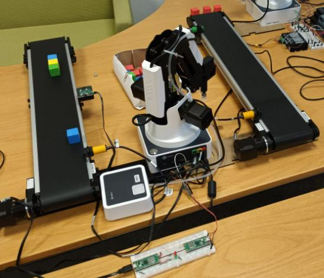
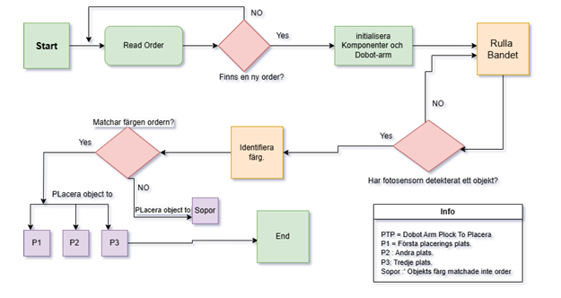
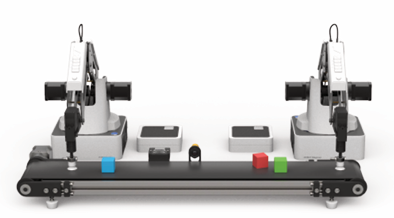
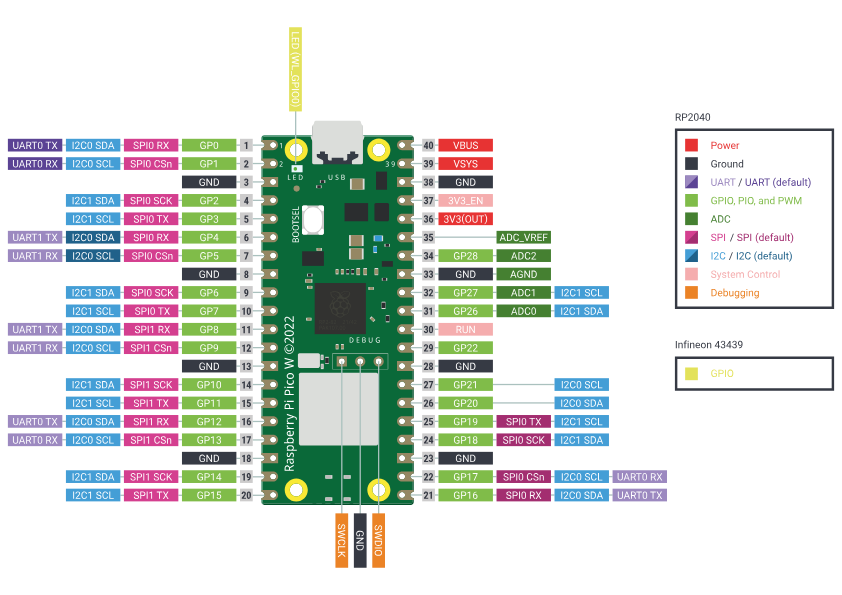
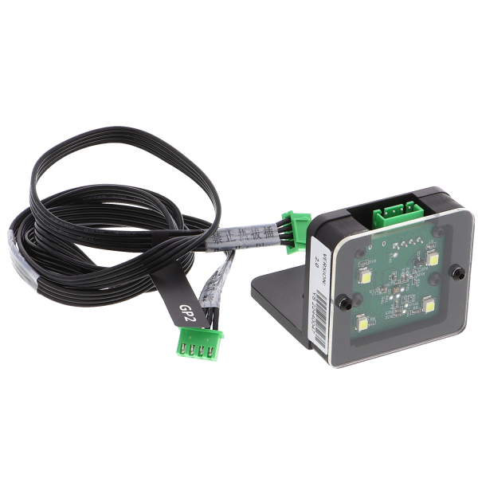
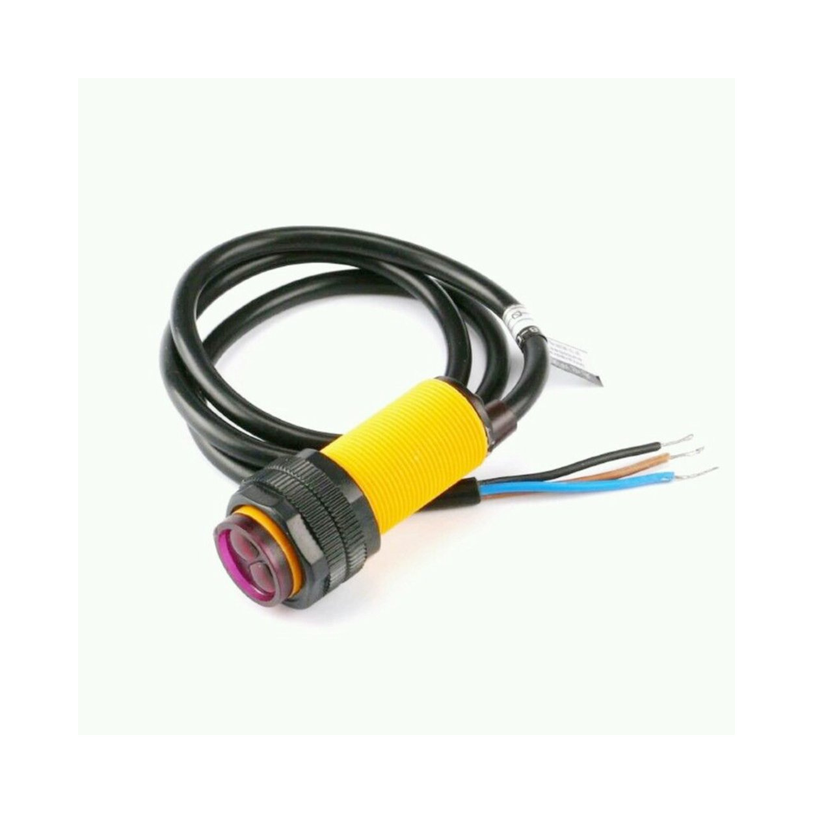

# Dobot Automated Sorting System

**Embedded Systems | Robotics | MicroPython | UART | Wi-Fi / TCP-IP**

**Halmstad University | Development Project | 2025**

## Project Overview

Developed an embedded robotic control solution using Raspberry Pi Pico and Dobot Magician as part of a collaborative automated sorting project.

The system receives sorting orders wirelessly from a client application through Wi-Fi and TCP/IP. A Raspberry Pi Pico server processes the order information and communicates with the Dobot Magician robotic arm via UART.

The sorting process involves object detection, color identification, and robotic pick-and-place operations based on the received order.

This repository focuses on embedded server functionality, robot communication, and hardware control rather than the web application.

## Project Demonstration

### Physical Prototype

<!-- IMAGE 1: Actual project prototype -->

*Physical prototype featuring the Dobot Magician robotic arm, conveyor system, sensors, and control hardware.*

## System Workflow

**Client Order → Wi-Fi / TCP-IP → Raspberry Pi Pico Server → UART → Dobot Magician → Object Sorting**

1. The client application sends a sorting order over Wi-Fi.
2. The Raspberry Pi Pico server receives and processes the order.
3. The conveyor and sensor system detects objects and identifies their colors.
4. Control commands are sent to the Dobot Magician through UART.
5. The robotic arm performs pick-and-place operations according to the order.

### Sorting Process Flowchart

<!-- IMAGE 2: Sorting flowchart -->

*Flowchart illustrating order reception, object detection, color identification, and robotic sorting.*

## Technical Implementation

- **MicroPython:** Embedded programming on Raspberry Pi Pico.
- **TCP/IP Sockets:** Wireless communication and order reception.
- **UART:** Serial communication between the microcontroller and robotic arm.
- **JSON:** Processing incoming order information.
- **Robot Control:** Movement commands and suction-based object handling.
- **Hardware Integration:** Coordination with conveyor and sensor functions.

### Hardware Configuration

<!-- IMAGE 3: Hardware illustration -->

*Illustration of the robotic sorting configuration with Dobot Magician arms, a conveyor belt, and colored objects.*

## Hardware Components

The embedded sorting system integrates a Raspberry Pi Pico,
Dobot Magician robotic arm, conveyor belt, color sensor,
and infrared object detection sensors.

### Raspberry Pi Pico

*Raspberry Pi Pico pinout showing GPIO and communication
interfaces used during embedded development.*

### Color Sensor

*Color sensor used to identify objects during the sorting
process.*

### Infrared Sensor

*Infrared sensor used to detect objects and support
conveyor-based positioning.*

## Source Code

The repository contains the following modules:

| Module | Description |
|---|---|
| `server.py` | TCP socket communication and incoming order processing |
| `wifi-pico.py` | Wireless connection and server command handling |
| `robot.py` | Dobot UART communication and robotic control |
| `band.py` | Conveyor-related control functions |
| `main.py` | Initialization and control integration |
| `mesage.py` | Communication message handling |

Some scripts represent separate development or testing stages and may require additional dependencies or configuration.

## Testing and Results

## Testing and Verification

The system was developed and verified using a step-by-step
testing approach, beginning with individual component tests
before integrating the complete sorting system.

### Unit Testing (Component Testing)

Each hardware component and communication function was
tested individually before system integration.

Tests included:

- **UART Communication:** Verified serial data transmission
  between Raspberry Pi Pico and Dobot Magician.
- **Robot Movement:** Tested positioning, point-to-point
  movements, and suction-based gripping.
- **Color Sensor:** Tested identification of red, green,
  and blue objects.
- **IR Sensor:** Verified object detection at selected
  conveyor positions.
- **Conveyor Belt:** Tested motor operation and movement
  control.
- **Wi-Fi / TCP-IP:** Verified wireless connectivity,
  server communication, and order reception.

### Integration Testing

After individual component verification, the modules
were combined and tested as an integrated system.

The integration tests focused on:

1. Receiving sorting orders from the client application.
2. Processing orders on the Raspberry Pi Pico server.
3. Coordinating sensors and conveyor operation.
4. Sending control commands to Dobot Magician via UART.
5. Executing robotic pick-and-place operations.
6. Verifying object placement according to the order.

### Test Results

According to the project report, 58 out of 60 object
placement attempts were successful, corresponding to
approximately **96.7% placement accuracy**.

The tests demonstrated the integration of communication,
sensing, conveyor operation, and robotic control.

## My Contribution

My work focused on embedded server development,
robotic control, hardware integration, and testing.

- Configured UART communication between Raspberry Pi Pico
  and Dobot Magician.
- Developed and integrated robot control functions.
- Implemented TCP/IP communication for order reception.
- Supported sensor and conveyor integration.
- Performed component-level testing of hardware and
  communication functions.
- Conducted integration testing to verify interaction
  between the embedded server, sensors, conveyor,
  and robotic arm.
- Troubleshot communication and hardware integration issues.

The overall system was developed collaboratively,
with additional components implemented by other
project members.

## Development Tools

- Raspberry Pi Pico
- Dobot Magician
- MicroPython
- Thonny IDE
- DobotStudio
- UART and TCP/IP communication

## Documentation

The project report contains further details about the system architecture, implementation, testing, and results.

*Note: This repository documents an academic prototype. Additional hardware configuration and software dependencies may be required to reproduce the complete system.*
